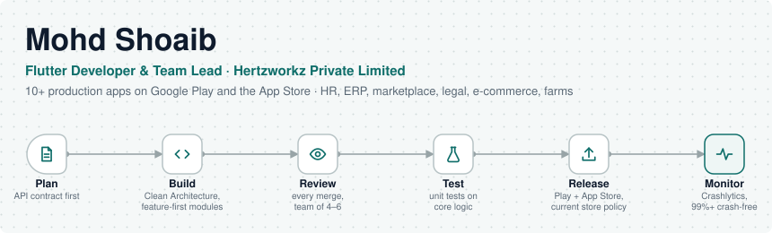

<picture>
  <source media="(prefers-color-scheme: dark)" srcset="assets/hero-dark.svg">
  
</picture>

I build Flutter apps of every kind and take them from the first screen to both stores. In 2+ years I have shipped 10+ production apps for HR, ERP, marketplace, legal, e-commerce and farm clients, and I lead a team of 4–6 developers at Hertzworkz Private Limited. Open to remote Flutter and mobile roles.

## What I build into an app

<picture>
  <source media="(prefers-color-scheme: dark)" srcset="assets/capabilities-dark.svg">
  
</picture>

## Products

| Product | What it does | Status |
|---|---|---|
| **MillGate HRMS** | HR for mills: 13 modules, background sync, an assistant chatbot for leave and complaints. In daily use by 3 organizations. | Live · [App Store](https://apps.apple.com/in/app/millgatehrms/id6757781681) · [Google Play](https://play.google.com/store/apps/details?id=com.hertzworkz.milgate_hrms.milgate_hrms) |
| **KKP Group** | Textile marketplace for admins, agents and buyers: Socket.IO chat, Agora calls on a native iOS CallKit screen, ML Kit turning chats into tracked inquiries. [Source](https://github.com/QuantumSharqwebteam/kkp_chat_app) | Live · [App Store](https://apps.apple.com/au/app/kkp-group/id6748518075) · [Google Play](https://play.google.com/store/apps/details?id=com.kkptextile.kkpchatapp) |
| **FlockMatrix** | Poultry farm management that works in sheds with no signal: flocks, feed, health, PDF and Excel reports in English, Hindi and Tamil. | Live · [App Store](https://apps.apple.com/us/app/flockmatrix/id6804997677) · Google Play |
| **Vakildot** | Legal consultation: real-time lawyer and client chat, Agora video calls with CallKit and background push. | Live · [Google Play](https://play.google.com/store/apps/details?id=com.vakildot.legal) |
| **HR super-app** | 20+ modules: attendance, leave, recruitment, payroll documents, chat, meetings and WebSocket calling. | In use at Hertzworkz |
| **ERP Lead App** | Metal-recycling plant ERP: gate pass, weighbridge, goods receipt, inventory, production, sales and logistics, with QR documents. In daily use by the client. | Live · Google Play |
| **ScaleAI** | Weighbridge operations on a phone: weighment queue, slips, reports. In daily use by the client. | Live · Google Play |
| **VitaYolkz** | Egg e-commerce: catalogue, cart, live delivery tracking on a map. | In development |

Client source code stays private; the store listings are public.

## How I work

- **Plan:** API contracts agreed with backend before screens are built; I fix backend bugs too (Node.js, Express).
- **Build:** Clean Architecture, feature-first modules, Provider or BLoC, GoRouter.
- **Review and test:** every merge reviewed; unit tests on core logic.
- **Release:** both stores, kept current with Apple and Google policy (target API level, Data safety, privacy manifests, account deletion).
- **Monitor:** Crashlytics, 99%+ crash-free sessions.
- **Secure by default:** tokens in Keychain and Keystore, no secrets in app code, obfuscated releases, role-based access.

## Open source

| Repo | What it is |
|---|---|
| [gts_parent_tracking](https://github.com/Shoaib20786/gts_parent_tracking) | Parent trip tracking: live OpenStreetMap route, plain-language safety alerts, SOS flow, unit tested |
| [support-voice-agent](https://github.com/Shoaib20786/support-voice-agent) | Turns a documentation site into a voice support agent that answers only from the docs |
| [ai-travel-agent](https://github.com/Shoaib20786/ai-travel-agent) | Day-by-day itineraries with live search, exported as a calendar file |
| [chat-with-pdf-rag](https://github.com/Shoaib20786/chat-with-pdf-rag) | Chat with a PDF through a retrieval pipeline, cloud or fully local |

The three agent repos are adapted from the open-source awesome-llm-apps collection (Apache-2.0) and maintained by me.

**Stack:** Flutter · Dart · BLoC · Provider · GoRouter · Firebase · REST · Socket.IO · WebSockets · Hive · WorkManager · Agora · CallKit · ML Kit · Razorpay · Stripe · AWS S3 · Node.js · Git

**Reach me:** [Portfolio](https://mohd-shoaib-portfolio.vercel.app) · [LinkedIn](https://linkedin.com/in/mohdshoaib1) · mohd.shoaib20786@gmail.com
