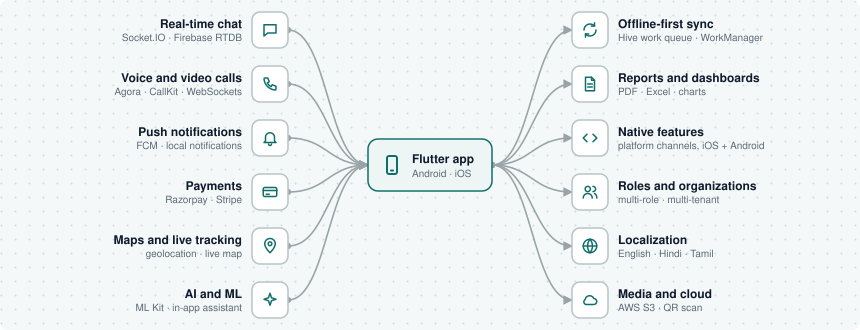
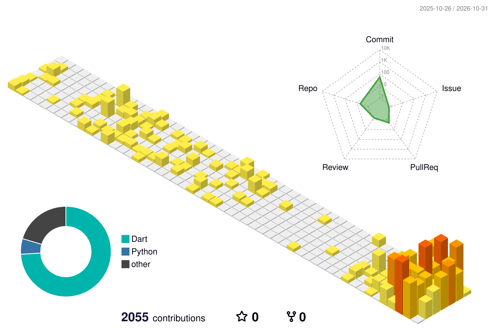

<picture>
  <source media="(prefers-color-scheme: dark)" srcset="assets/profile-dark.svg">
  
</picture>

  <a href="https://mohd-shoaib-portfolio.vercel.app"><b>Portfolio</b></a> ·
  <a href="https://linkedin.com/in/mohdshoaib1"><b>LinkedIn</b></a> ·
  <a href="mailto:mohd.shoaib20786@gmail.com"><b>Email</b></a> ·
  Open to remote Flutter and mobile roles

I build Flutter apps of every kind and take them from the first screen to both stores, plus the AI agents, automation and tools around them. 10+ production apps for HR, ERP, marketplace, legal, e-commerce and farm clients; team lead for 4–6 developers at Hertzworkz Private Limited.

## Tech stack

| | |
|---|---|
| **Mobile** |  |
| **Backend and cloud** |  |
| **Tools** |  |
| **In my apps** | Provider · BLoC · GoRouter · Socket.IO · WebSockets · Agora · CallKit · Hive · WorkManager · ML Kit · Razorpay · Stripe · FCM · Crashlytics |
| **AI and automation** | n8n · LLM APIs · tool calling · retrieval (RAG) · WhatsApp Cloud API |

## Portfolio

<picture>
  <source media="(prefers-color-scheme: dark)" srcset="assets/app-kkp-dark.svg">
  
</picture>

[App Store](https://apps.apple.com/au/app/kkp-group/id6748518075) · [Google Play](https://play.google.com/store/apps/details?id=com.kkptextile.kkpchatapp) · [Source](https://github.com/QuantumSharqwebteam/kkp_chat_app)

<picture>
  <source media="(prefers-color-scheme: dark)" srcset="assets/app-millgate-dark.svg">
  
</picture>

[App Store](https://apps.apple.com/in/app/millgatehrms/id6757781681) · [Google Play](https://play.google.com/store/apps/details?id=com.hertzworkz.milgate_hrms.milgate_hrms)

<picture>
  <source media="(prefers-color-scheme: dark)" srcset="assets/app-flockmatrix-dark.svg">
  
</picture>

[App Store](https://apps.apple.com/us/app/flockmatrix/id6804997677) · Google Play

**More apps I built**

| App | What it does | Status |
|---|---|---|
| **Vakildot** | Legal consultation: real-time lawyer and client chat, Agora video calls with CallKit and background push | Live · [Google Play](https://play.google.com/store/apps/details?id=com.vakildot.legal) |
| **ERP Lead App** | Metal-recycling plant ERP: gate pass, weighbridge, goods receipt, inventory, production, sales, logistics, QR documents | Live · Google Play, in daily client use |
| **ScaleAI** | Weighbridge operations on a phone: weighment queue, slips, reports | Live · Google Play, in daily client use |
| **HR super-app** | 20+ modules: attendance, leave, recruitment, payroll documents, chat, meetings, WebSocket calling | In use at Hertzworkz |
| **VitaYolkz** | Egg e-commerce: catalogue, cart, live delivery tracking on a map | In development |

Client source code stays private; the store listings are public.

## What I build into an app

<picture>
  <source media="(prefers-color-scheme: dark)" srcset="assets/capabilities-dark.svg">
  
</picture>

## Apps, agents and tools

<picture>
  <source media="(prefers-color-scheme: dark)" srcset="assets/desk-dark.svg">
  
</picture>

| Repo | What it is |
|---|---|
| [gts_parent_tracking](https://github.com/Shoaib20786/gts_parent_tracking) | Flutter: parent trip tracking with a live OpenStreetMap route, plain-language safety alerts and an SOS flow, unit tested |
| [support-voice-agent](https://github.com/Shoaib20786/support-voice-agent) | AI agent: turns a documentation site into a voice support agent that answers only from the docs |
| [ai-travel-agent](https://github.com/Shoaib20786/ai-travel-agent) | AI agent: day-by-day itineraries with live search, exported as a calendar file |
| [chat-with-pdf-rag](https://github.com/Shoaib20786/chat-with-pdf-rag) | AI agent: chat with a PDF through a retrieval pipeline, cloud or fully local |

The three agent repos are adapted from the open-source awesome-llm-apps collection (Apache-2.0) and maintained by me.

## GitHub activity

<picture>
  <source media="(prefers-color-scheme: dark)" srcset="assets/contrib-dark.svg">
  
</picture>

<picture>
  <source media="(prefers-color-scheme: dark)" srcset="profile-3d-contrib/profile-night-rainbow.svg">
  
</picture>

<picture>
  <source media="(prefers-color-scheme: dark)" srcset="https://raw.githubusercontent.com/Shoaib20786/Shoaib20786/output/github-snake-dark.svg">
  
</picture>

Much of my client work is committed from my Hertzworkz company account, so these graphs show only part of it.

## How I work

- **Plan:** API contracts agreed with backend before screens are built; I fix backend bugs too (Node.js, Express).
- **Build:** Clean Architecture, feature-first modules, Provider or BLoC, GoRouter.
- **Review and test:** every merge reviewed, unit tests on core logic.
- **Release:** both stores, kept current with Apple and Google policy (target API level, Data safety, privacy manifests, account deletion).
- **Monitor:** Crashlytics, 99%+ crash-free sessions.
- **Secure by default:** tokens in Keychain and Keystore, no secrets in app code, obfuscated releases, role-based access.

## Now

- **Flutter starter kit (in build):** a production-grade base for real apps on the latest stable Flutter: Supabase backend, Riverpod, sign-in, payments (Razorpay for real-world orders, RevenueCat for in-app purchases), a full notifications module (push, local, scheduled), an experimental AI Lab, and tests at every level (unit, widget, golden, end-to-end).
- **AI agents for businesses:** lead qualification and booking agents on n8n and LLM APIs, with WhatsApp and calendar tools.
- **Node.js:** writing the APIs and automation behind my own projects.

<a href="https://mohd-shoaib-portfolio.vercel.app">mohd-shoaib-portfolio.vercel.app</a> · <a href="https://linkedin.com/in/mohdshoaib1">linkedin.com/in/mohdshoaib1</a> · mohd.shoaib20786@gmail.com

